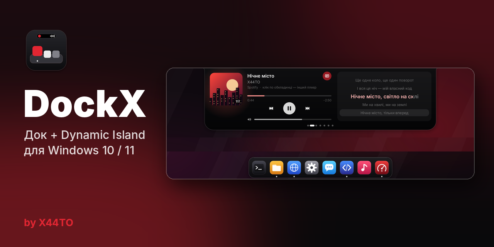
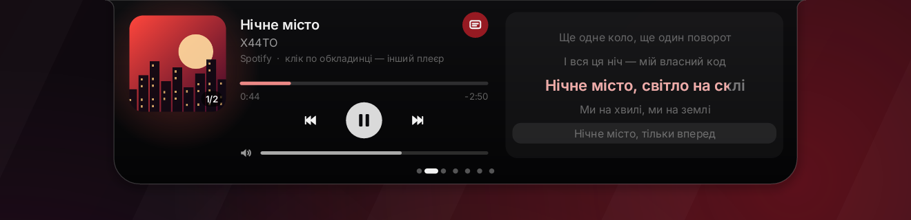
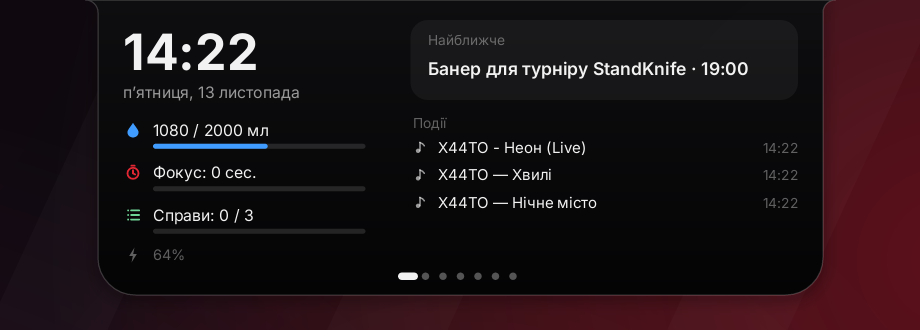
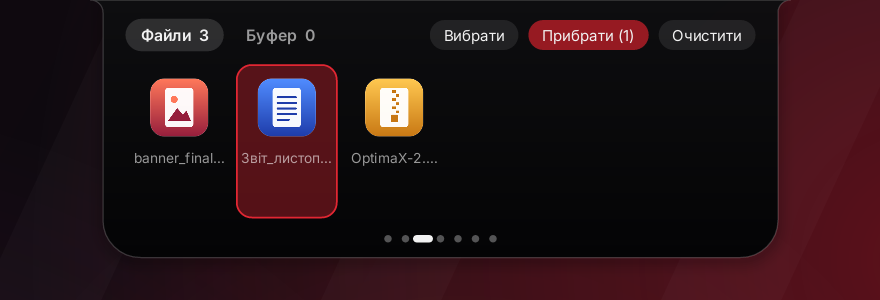
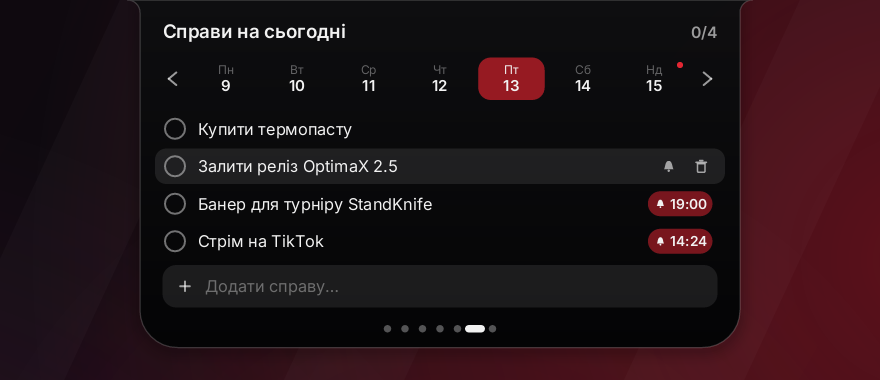
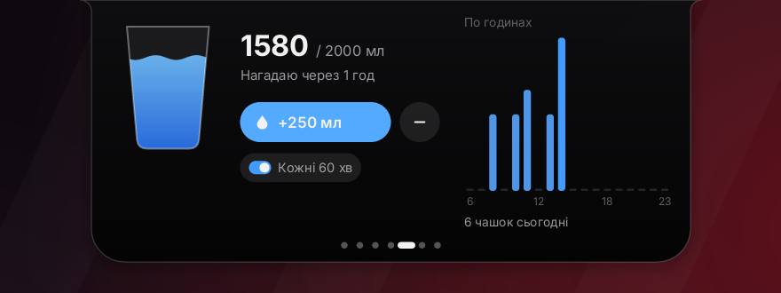
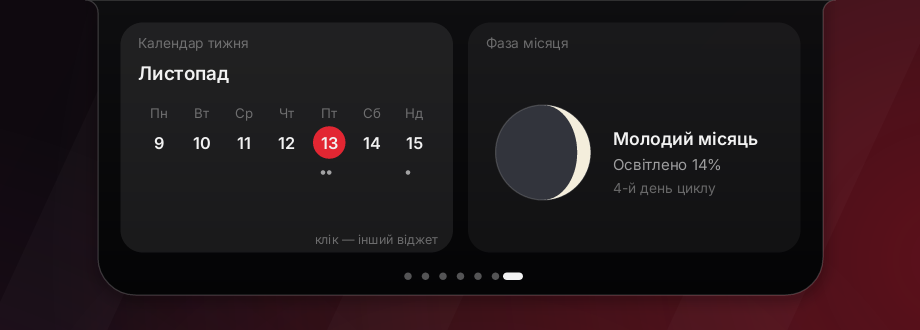
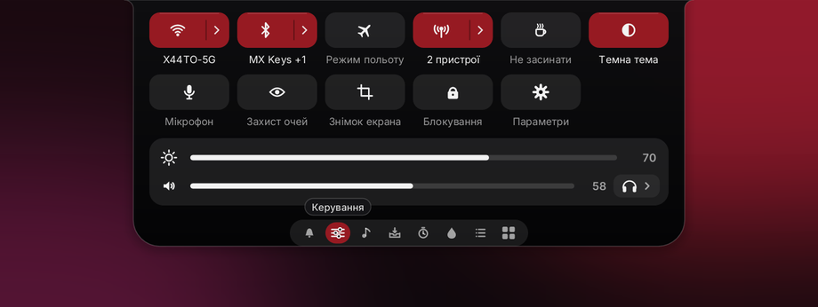
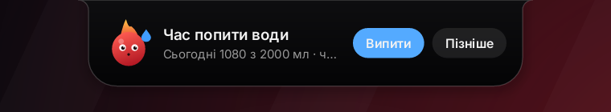
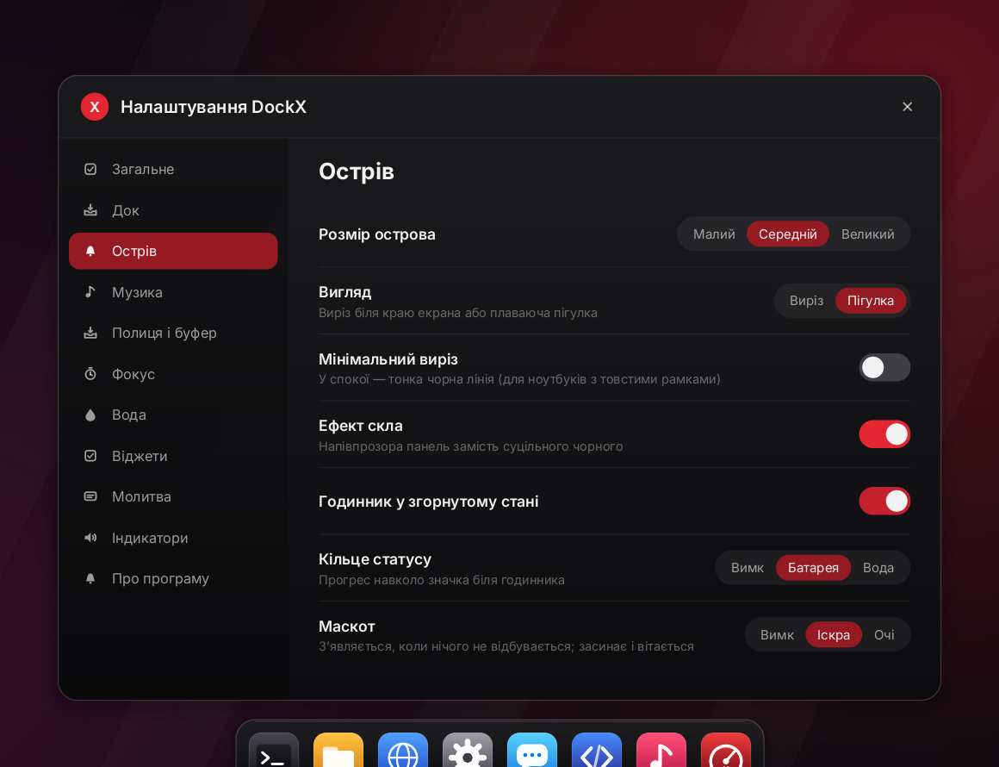

<p align="center">
  
</p>

<p align="center">
  <a href="https://github.com/hatogg/DockX/releases/latest/download/DockX-Setup.exe"></a>
  &nbsp;
  <a href="https://github.com/hatogg/DockX/releases/latest"></a>
</p>

<p align="center">
  
  
  
  
</p>

**DockX** — док у стилі macOS і Dynamic Island для Windows. Обидва в одній програмі на 1,5 МБ, написаній на Rust. Без .NET, рантаймів, реклами й трекерів, українською.

<sub>🇬🇧 DockX is a macOS-style dock plus a Dynamic Island for Windows 10/11 in one 1.5 MB Rust app: music with synced lyrics, file shelf, clipboard history, focus timer, water tracker, to-dos with reminders, widgets, quick settings (Wi-Fi, Bluetooth, brightness, volume) and system indicators.</sub>

<p align="center">
  <a href="docs/DockX-demo.mp4"><b>▶ Відео з усіма функціями (3,5 хв)</b></a>
</p>

## Dynamic Island

<p align="center"></p>

**Музика з будь-якого плеєра.** Острів бачить усе, що є в системній медіапанелі Windows: Spotify, YouTube / YouTube Music / SoundCloud у Chrome, Edge, Firefox чи Opera, Apple Music, Медіапрогравач, VLC. Є обкладинка, прогрес, перемотка, пауза, попередній і наступний трек, гучність (повзунок або колесо миші). Клік по обкладинці перемикає між плеєрами.

**Синхронні тексти пісень.** Текст показується в тому ж острові поруч із плеєром, рядок підсвічується як у караоке, а клік по рядку перемотує пісню на цей момент. Тексти беруться з відкритої бази [LRCLIB](https://lrclib.net). У згорнутому стані поточний рядок видно під островом.

<p align="center">
  
</p>

**Керування.** Швидкі перемикачі прямо в острові: Wi-Fi, Bluetooth (з назвами підключених пристроїв), режим польоту, мобільна точка доступу (з кількістю пристроїв), «Не засинати», темна тема, мікрофон, захист очей (теплий екран), знімок екрана, блокування і параметри Windows. Нижче повзунки яскравості й гучності та перемикання виходу звуку (навушники, колонки). Стрілка «›» біля Wi-Fi, Bluetooth і точки доступу відкриває їхні налаштування.

| | |
|---|---|
|  **Сьогодні.** Годинник, вода, фокус, справи, найближча подія і стрічка подій острова. |  **Полиця і буфер.** Кидай файли на острів і витягай куди треба, кілька за раз. Поруч історія скопійованих текстів і посилань. |
|  **Справи.** Календар тижня, нагадування на час (`Стрім @20:00`), зміна порядку перетягуванням. |  **Вода.** Об'єм чашки, денна норма в мл, нагадування і графік по годинах. |
|  **Віджети.** Календар тижня, світовий час, фаза місяця, зворотний відлік, батарея, вода, фокус. |  **Керування.** Wi-Fi, Bluetooth, режим польоту, точка доступу, тема, мікрофон, яскравість, гучність і вихід звуку. |

**І ще:**
- фокус-таймер на 4 раунди, що живе навіть у згорнутому острові;
- сповіщення для води, кінця сесії фокусу, справ і низького заряду;
- індикатори гучності, яскравості, Caps Lock і мови клавіатури;
- картки при підключенні зарядки, змінах Wi-Fi і підключенні навушників;
- годинник із кільцем статусу (батарея або вода);
- маскот «Іскра» або просто очі: з'являється, коли за ПК нікого немає, засинає, а при наведенні курсора вітається;
- вигляди: виріз, плаваюча пігулка, мінімальний виріз (тонка лінія), ефект скла, три розміри.

<p align="center"></p>

## Док

<p align="center"></p>

- Пружинне збільшення іконок, як у macOS. Іконки підтягуються з Windows у високій роздільності.
- При запуску програми іконка підстрибує, поки програма не відкриється. Крапка під іконкою означає, що програма запущена; клік переключає на її вікно.
- Програми, ярлики й папки додаються перетягуванням: для них відкривається місце. Перетягни файл на іконку програми, щоб відкрити його в ній.
- Порядок змінюється перетягуванням. Щоб прибрати іконку, потягни її вгору (зникає з «пуфом»).
- Перейменування прямо в підписі над іконкою, запуск від імені адміністратора, нове вікно.
- Автоприховування. У повноекранних іграх і відео док і острів ховаються, щоб не впливати на FPS і затримку.
- Кадри синхронізовані з частотою монітора (60, 120, 144 Гц і т. д.). Коли нічого не рухається, програма не малює і майже не навантажує процесор.

## Налаштування

<p align="center"></p>

ПКМ по доку або острову → «Налаштування…». Розділи: Загальне, Док, Острів, Музика, Полиця і буфер, Фокус, Вода, Віджети, Індикатори, Про програму. Усе застосовується одразу.

## Встановлення

1. Завантаж [**DockX-Setup.exe**](https://github.com/hatogg/DockX/releases/latest/download/DockX-Setup.exe) і запусти.
2. Права адміністратора не потрібні: DockX ставиться в `%LOCALAPPDATA%\Programs\DockX`. Інсталятор створить ярлики, за бажанням увімкне автозапуск і додасть DockX у «Програми та компоненти».
3. Exe не підписаний, тому SmartScreen може попередити: «Докладніше» → «Виконати все одно».

Портативна версія: [**DockX-portable.zip**](https://github.com/hatogg/DockX/releases/latest/download/DockX-portable.zip). Розпакуй і запусти `DockX.exe`.

Під час оновлення інсталятор сам закриває запущений DockX, а налаштування, справи й полиця зберігаються. Видалення: «Програми та компоненти» → DockX. На запитання, чи видаляти налаштування, можна відповісти «Ні».

## Що не робить і чому

Перехоплювати системні сповіщення Windows дозволено лише програмам з Microsoft Store. Замість цього на сторінці «Сьогодні» є стрічка подій острова.

## Файли

| Що | Де |
|---|---|
| Налаштування й іконки дока | `%APPDATA%\DockX\dock.ini` |
| Справи, вода, полиця, статистика | `%APPDATA%\DockX\island.dat` |
| Кеш текстів пісень | `%APPDATA%\DockX\lyrics\` |
| Помилки (надішли, якщо щось не так) | `%APPDATA%\DockX\error.log` |

## Збірка

```sh
# Windows
cargo build --release            # target\release\DockX.exe

# Linux → Windows (Rust 1.97 + MinGW), як збирається реліз
./build.sh
makensis installer/dockx.nsi     # інсталятор у dist/
```

`cargo run --release --bin demo <папка> | ffmpeg …` рендерить демо-відео тим самим кодом малювання, що й програма.

| Папка | Що всередині |
|---|---|
| `src/ui/` | Малювання, док, острів, налаштування. Не залежить від Windows, тому з того ж коду рендериться відео. |
| `src/win/` | Шар Windows: layered-вікна, vsync-цикл, медіасесія (GSMTC), WinHTTP, OLE drag & drop, меню, батарея, гучність, Wi-Fi, яскравість. |
| `installer/` | Інсталятор NSIS. |
| `brand/` | Іконка, картинки інсталятора й обкладинки (Python + Pillow). |

<p align="center">
  <a href="https://t.me/ttx44to"></a>
</p>
